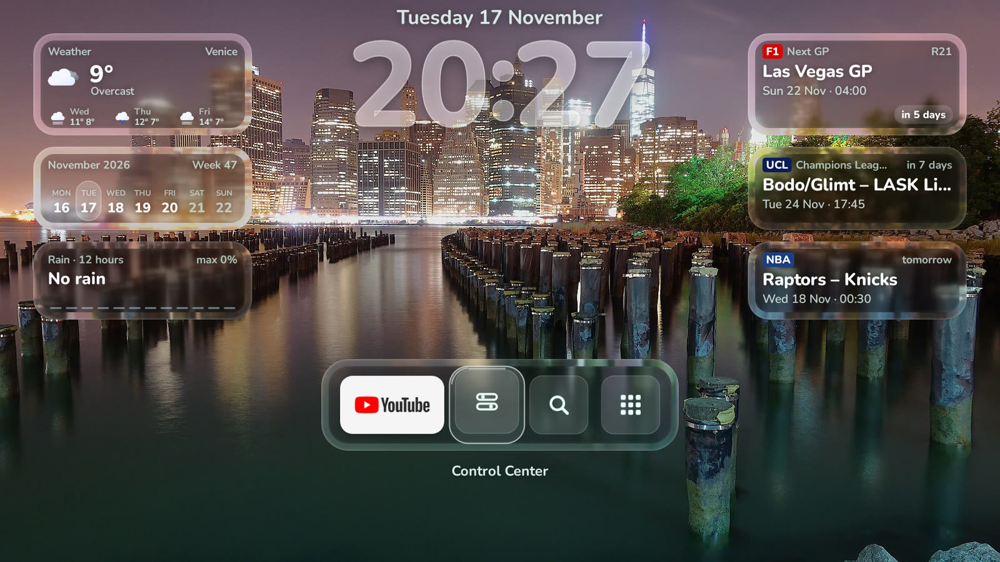
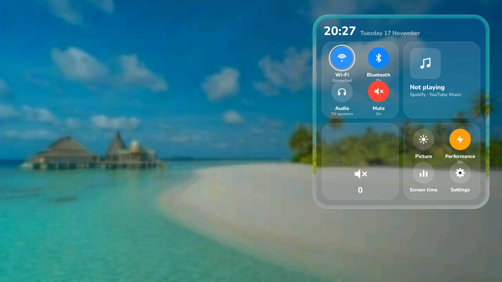
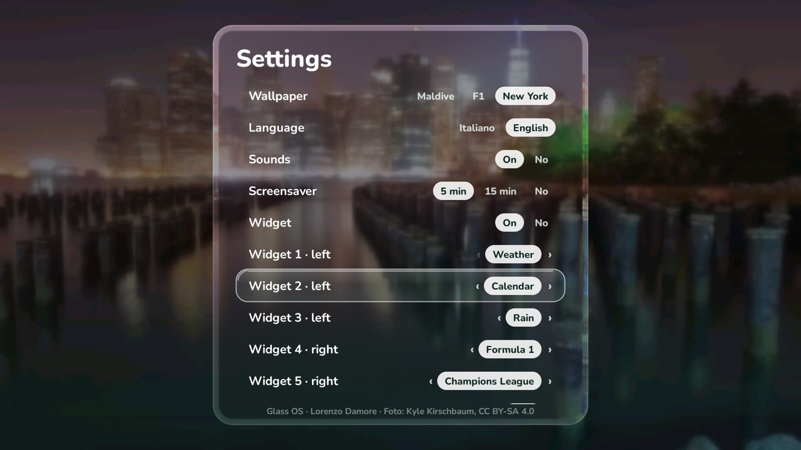
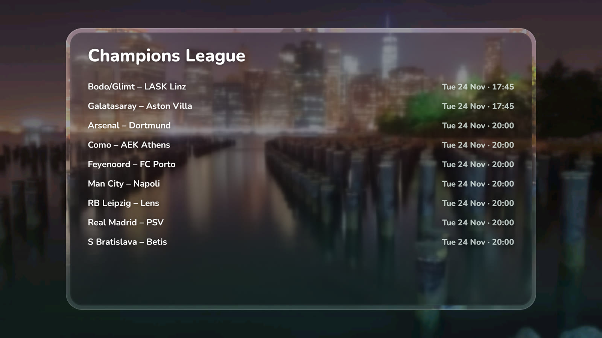
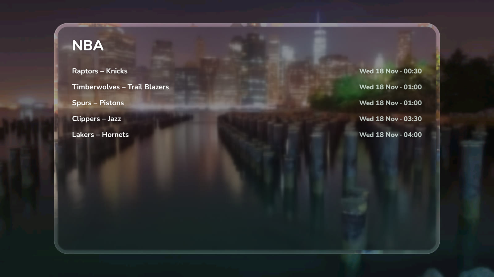
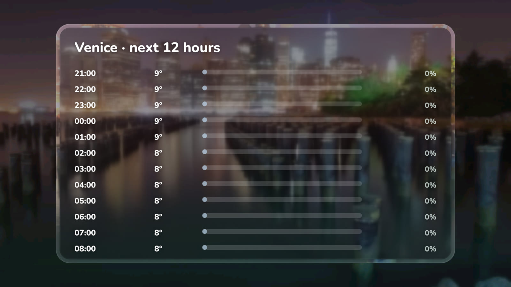

# Glass OS

**A liquid-glass home screen for Android TV — native, 60 fps, built from scratch.**

🌐 **Website: [glass-os-dmr.web.app](https://glass-os-dmr.web.app)** · ⬇️ **[Download the latest APK](../../releases/latest)**

Glass OS replaces the stock Android TV launcher with a translucent, iOS-style "liquid glass" interface. Since version 3 it is fully native (no WebView): every glass panel is pre-rendered once and each frame only moves images, so it stays at 60 fps even on a budget TV.


## What's new in 3.1

- **Free widgets** — weather, calendar, rain in the next 12 hours, temperature hour by hour.
- **Pro widgets you choose** — six slots, each one picked from 24 options: Formula 1, MotoGP, ATP and WTA tennis, Serie A, Premier League, LaLiga, Bundesliga, Ligue 1, Champions League, Europa League, MLS, NBA, NFL, NHL, MLB, PGA golf, UFC and more. Live scores update every minute; select a widget to open the full schedule.
- **Weather where you are** — the city is detected automatically, the language follows your TV.

| Depth effect | Control Center |
|---|---|
|  |  |

| Pick your widgets (Pro) | Champions League |
|---|---|
|  |  |

| NBA | Next 12 hours |
|---|---|
|  |  |

## Features

- **Liquid glass everywhere** — real background refraction on every panel and a glass "drop" that slides between apps with spring physics.
- **Glass clock with depth** — like the iPhone lock screen, the city skyline stands in front of the time.
- **Control Center** — volume, Bluetooth, Wi-Fi, picture, performance mode and HDMI inputs in one panel.
- **Profiles** — "Who's watching?", with an optional PIN.
- **Music player** — cover art and synced lyrics for what's playing.
- **Search** — YouTube or Spotify straight from the remote.
- **Auto updates** — new versions download by themselves; one OK on the remote installs them.


## Free and Pro

| | Free | Pro |
|---|---|---|
| Liquid-glass home, clock, dock, Control Center | ✓ | ✓ |
| Weather, rain, temperature, calendar widgets | ✓ | ✓ |
| Sports widgets and custom layout | | ✓ |
| More wallpapers, alerts, extra profiles | | ✓ |
| Price | 0 € | 4.99 € one time — coming soon on Google Play |

No ads, no subscription.

## Install

1. Download `GlassOS.apk` from the [website](https://glass-os-dmr.web.app) or from [Releases](../../releases/latest).
2. Install it on an Android TV / Google TV (Android 6+) with "Install unknown apps" enabled (for example with the free *Downloader* app), or via `adb install`.
3. Open Glass OS and pick your profile.

Optional, via adb, so Glass OS can show the music player and alerts over other apps:
```
adb shell appops set it.damore.glasstv SYSTEM_ALERT_WINDOW allow
adb shell cmd notification allow_listener it.damore.glasstv/it.damore.glasstv.MediaListener
```

## Tech

Native Java: one custom View drawn on a hardware-accelerated Canvas, glass panels pre-rendered into bitmaps, spring animations on the Choreographer. Tuned frame by frame on a real budget TCL TV (0% janky frames in the dock).

Made by **Lorenzo Damore**.
