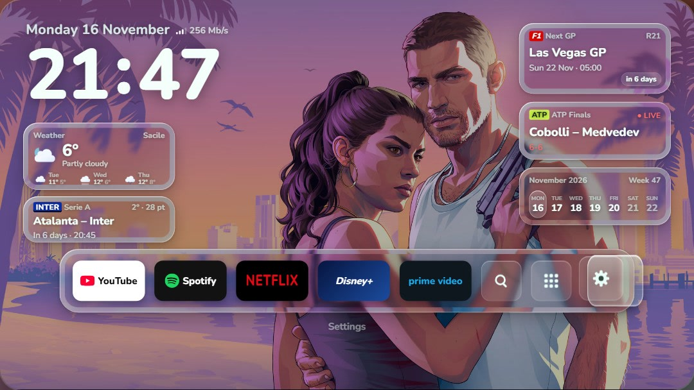
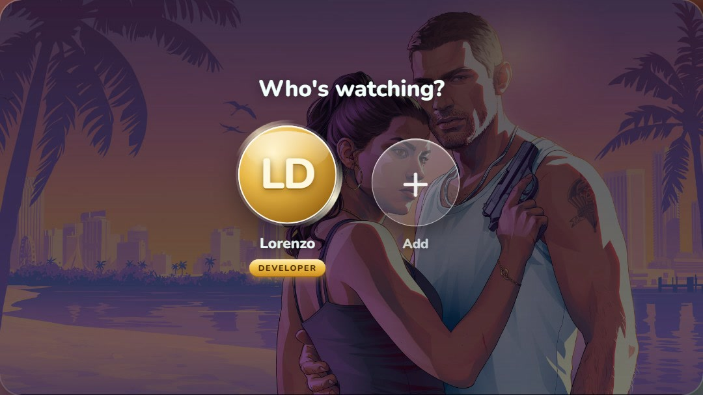
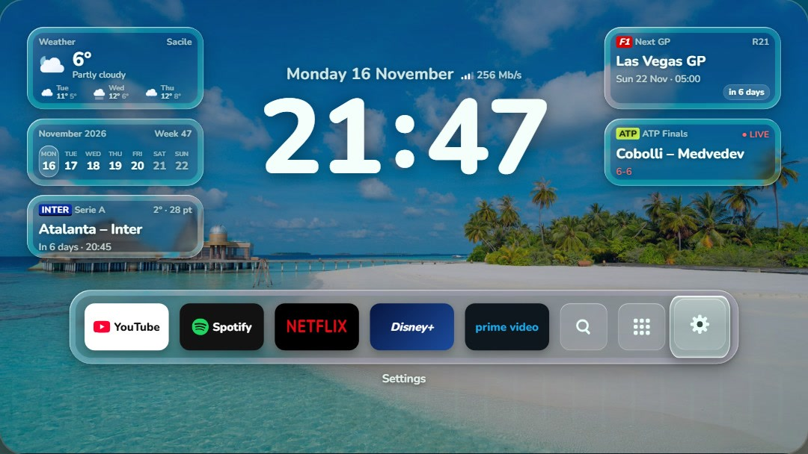

# Glass OS

**A liquid-glass home screen for Android TV — built from scratch.**

Glass OS replaces the stock Android TV launcher with a translucent, iOS-style "liquid glass" interface that runs smoothly even on budget TVs. Plug in the USB stick and Glass OS takes over; it also opens every time the TV turns on. Choose "Exit Glass OS" and you're back to the normal home screen.



## Features

- **Liquid glass everywhere** — real background refraction on every panel, a glass "drop" that slides between apps with spring physics, all pre-computed so cheap TV GPUs keep up.
- **Animated boot** — a glass drop falls, ripples, and turns into the Glass OS logo.
- **Profiles** — Netflix-style "Who's watching?", 50 3D avatars, an optional PIN for each profile.
- **Wallpapers** — GTA VI (Jason & Lucia) or a real Maldives beach, plus your own photos from the USB stick. The light follows the time of day, and real rain or snow appears when it's raining outside.
- **Live widgets** — weather, calendar, next F1 Grand Prix, live ATP tennis and Inter (Serie A) scores. Select any widget to open a full page.
- **Music player** — cover art, a glow that matches the album colors, and synced lyrics.
- **Search everywhere** — glass on-screen keyboard or voice, then pick YouTube, Spotify, Netflix, Disney+, Prime Video…
- **Alerts over any app** — F1 sessions, tennis matches, Inter goals, rain on the way.
- **Phone remote** — scan a QR code and your phone becomes a touchpad, keyboard, volume control and app launcher.
- **Folders** — apps sorted automatically (Streaming, Music, Sports, Games, System), movable with a long press.
- **Auto updates** — new versions download by themselves; one OK on the remote installs them.

| Profiles | Maldives wallpaper |
|---|---|
|  |  |

## Install

1. Download `GlassOS.apk` from [Releases](../../releases).
2. Install it on an Android TV / Google TV (Android 6+) with "Install unknown apps" enabled, or via `adb install`.
3. Optional, via adb, so Glass OS can open by itself and read what's playing:
   ```
   adb shell appops set it.damore.glasstv SYSTEM_ALERT_WINDOW allow
   adb shell cmd notification allow_listener it.damore.glasstv/it.damore.glasstv.MediaListener
   ```

## Tech

HTML/CSS/JS interface inside a full-screen WebView, with a small Java layer for apps, media sessions, USB detection, overlays, the phone-remote server and updates. Every animation runs on the GPU (Web Animations API) — the design was tuned frame by frame on a real budget TCL TV.

Made by **Lorenzo Damore**.
